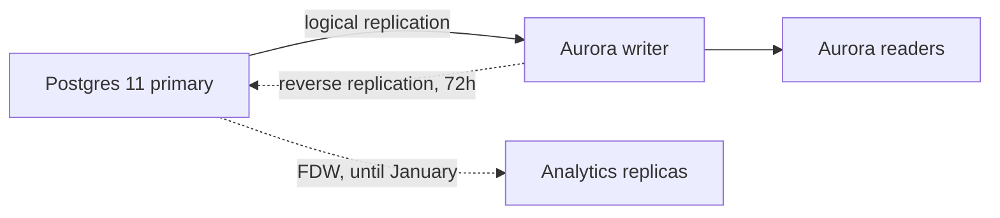

# Q4 data migration plan

Move the `orders` and `billing` tables from the legacy Postgres 11 cluster to the new Aurora cluster with no more than **5 minutes** of write downtime, finishing before the *December freeze*. Background is in the [replication RFC](https://example.com/rfc/412) and the original capacity review.[^capacity]

## Scope

Three schemas move this quarter. Analytics replicas stay on the old cluster until January and read through a foreign data wrapper in the meantime.

- `orders` — 1.8 TB, 412M rows, highest write volume
- `billing` — 240 GB, includes the Stripe event ledger
  - Ledger events are append-only
  - Refunds reference ledger rows by sequence number
    - Sequence gaps must survive replay
- `catalog` — 36 GB, read-heavy, safe to move first

### Order of operations

1. Dry run on `catalog` with row-count and checksum diff
2. Logical replication for `orders`
   1. Snapshot from the replica, not the primary
   2. Start the slot before the snapshot completes
3. Billing cutover, once the replay test passes twice
4. Decommission the old cluster

## Phases

| Phase | Window | Owner | Rows | Status |
| :--- | :--- | :--- | ---: | :---: |
| 1. Catalog dry run | Oct 7 – Oct 11 | Maya Chen | 18,204,113 | Done |
| 2. Logical replication for orders | Oct 14 – Oct 25 | Sam Ruiz | 412,880,051 | In progress |
| 3. Billing cutover | Nov 4 – Nov 8 | Dana Okafor | 96,402,770 | At risk |
| 4. Decommission old cluster | Dec 2 – Dec 6 | Theo Park | — | Not started |

> Billing cutover is at risk until we confirm the ledger's sequence gaps are safe to replay. Don't schedule the window until the replay test passes twice in staging.
>
> — Dana Okafor, review on v6

## Cutover procedure

Run from the bastion host. The script pauses writers, waits for replication lag to reach zero, then flips the connection string in the config service. It is safe to interrupt only before step 2.

```bash
# 1. Freeze writers and wait for lag to drain
./bin/cutover --schema orders --pause-writers
./bin/lag --until 0 --timeout 240s

# 2. Flip the DSN and resume
cfg set db.orders.dsn "$AURORA_ORDERS_DSN"
./bin/cutover --schema orders --resume
```

The lag check is a small TypeScript helper. Its last line is deliberately long so the code block has to scroll:

```ts
import { connect, type Pool } from "./db";

interface LagSample {
  slot: string;
  bytes: number;
  at: Date;
}

export async function waitForLag(pool: Pool, limit = 0, timeoutMs = 240_000): Promise<LagSample> {
  const started = Date.now();
  while (Date.now() - started < timeoutMs) {
    const sample = await readLag(pool); // bytes behind the primary
    if (sample.bytes <= limit) return sample;
    await new Promise((resolve) => setTimeout(resolve, 1_000));
  }
  throw new Error(`replication lag did not reach ${limit} bytes within ${timeoutMs / 1000}s; check pg_stat_replication on the old primary and the Aurora writer before retrying the cutover`);
}
```

```json
{ "schema": "orders", "pauseWriters": true, "timeout": "240s", "dryRun": false }
```

### Rollback

If the error rate on `/checkout` exceeds 0.5% for two minutes, point the DSN back at the old primary. Reverse replication stays on for 72 hours after each cutover.[^reverse]

## Data flow




---

## Before Nov 4

- [x] Provision Aurora cluster and parameter groups
- [x] Catalog dry run with row-count and checksum diff
- [ ] Ledger replay test passes twice in staging
  - [x] First pass, Oct 16
  - [ ] Second pass
- [ ] Load test checkout at 2× peak against Aurora
- [ ] Post the cutover window in #eng-announce 48 hours ahead

After the cutover:

- [ ] Drop the foreign data wrapper once analytics moves.

  Analytics reads through it until January.

- [x] Archive the old cluster's final snapshot.

#### Open questions

##### Owners

###### Escalation

Who approves a rollback after hours? Until decided, the on-call database engineer does.

[^capacity]: The capacity review assumed 14% quarter-over-quarter growth in `orders`; actual growth was 19%.
[^reverse]: Reverse replication doubles WAL volume on Aurora, so watch storage alarms during those 72 hours.
